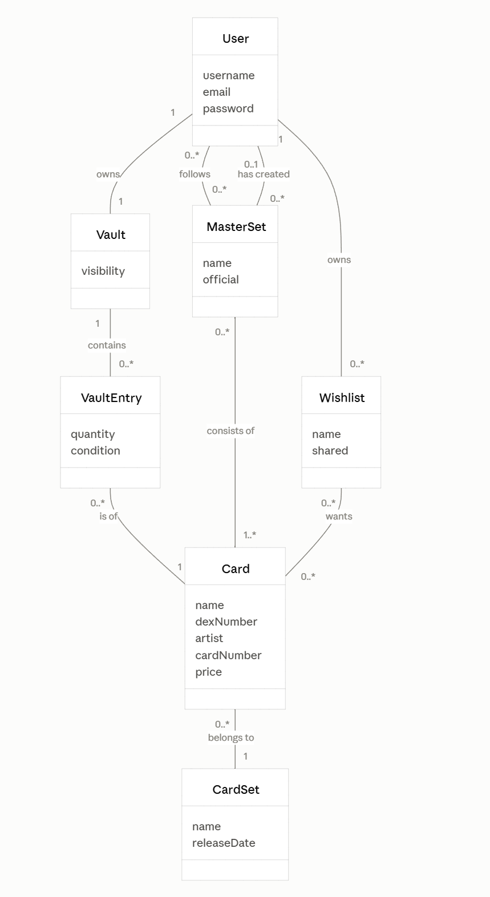

# Domæne model

Domænemodellen beskriver de begreber, MasterCollect handler om, og hvordan de hænger sammen. Den er afgrænset til MVP (need to have).

## Begreber

- **User**: En person med en profil i appen. Har brugernavn, email og password.
- **Vault**: Brugerens vault/inventory over de kort, vedkommende ejer. Kan være privat eller offentlig.
- **VaultEntry**: Ét kort i en samling, med antal og stand. Gør det muligt at eje flere eksemplarer af samme kort.
- **Card**: Et Pokémon TCG-kort med navn, dex-nr, kunstner, kortnummer og pris.
- **CardSet**: Et officielt kortsæt (fx Base Set), som kort tilhører.
- **MasterSet**: Et mål om at samle en bestemt mængde kort. Er enten officielt (ingen skaber) eller oprettet af en bruger. Fremgang i procent beregnes ud fra brugerens samling og indgår derfor ikke som eget begreb.
- **Wishlist**: En liste over kort, brugeren ønsker sig. Kan deles via link.

## Relationer

- En bruger ejer én samling, og samlingen indeholder nul eller flere samlingsposter. Hver samlingspost er af ét kort.
- Et kort tilhører ét set.
- Et master-set består af mindst ét kort. En bruger kan følge flere master-sets og oprette egne.
- En bruger kan have flere wishlists, og en wishlist kan indeholde mange kort.

## Uden for scope (nice to have)

Kommentarer og reaktioner (like/dislike), byt-funktion og achievements er ikke med i modellen endnu.